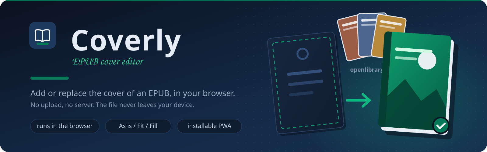
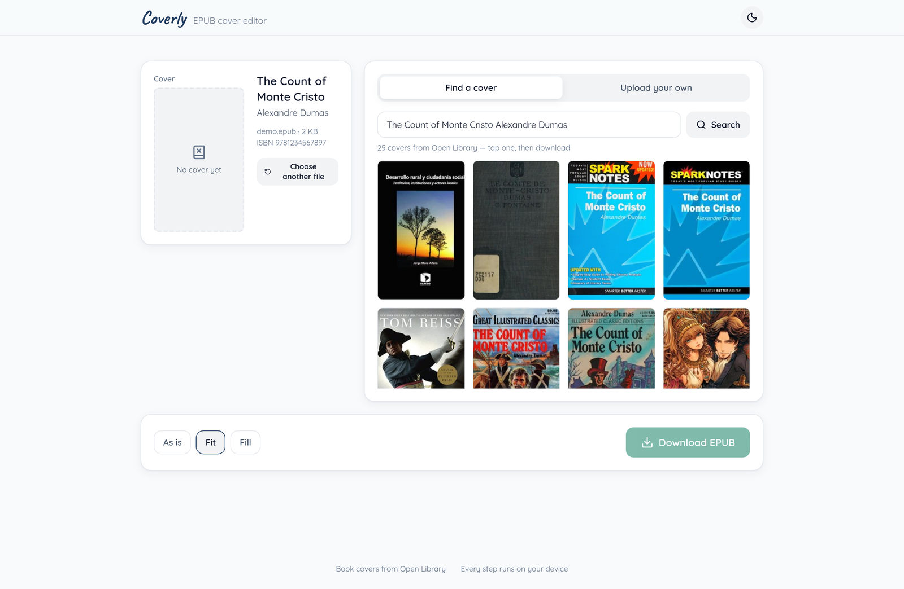
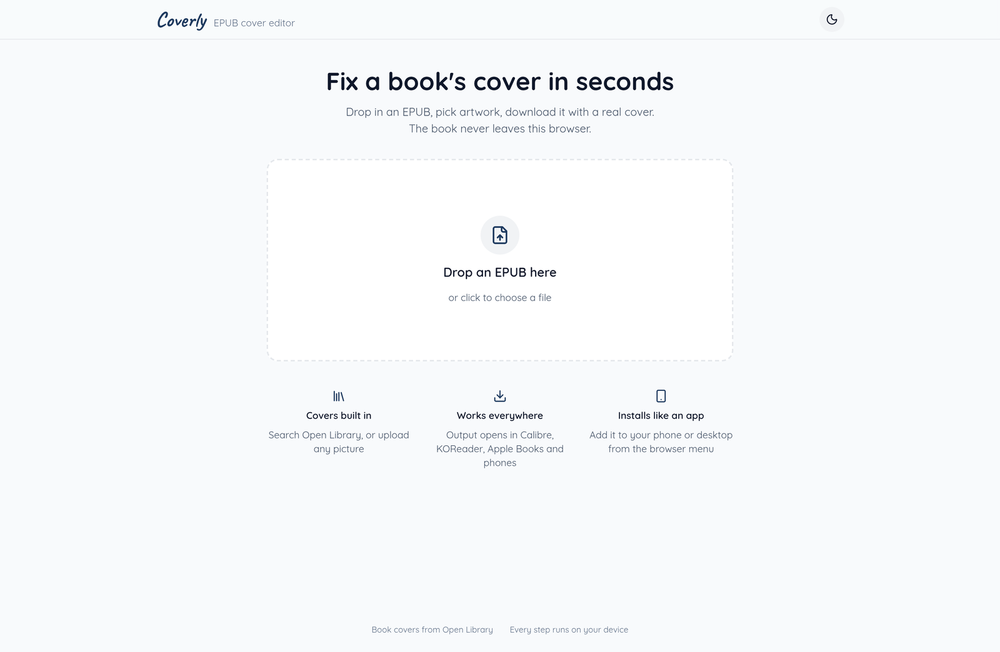
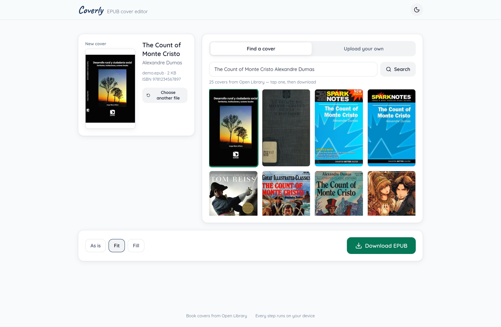
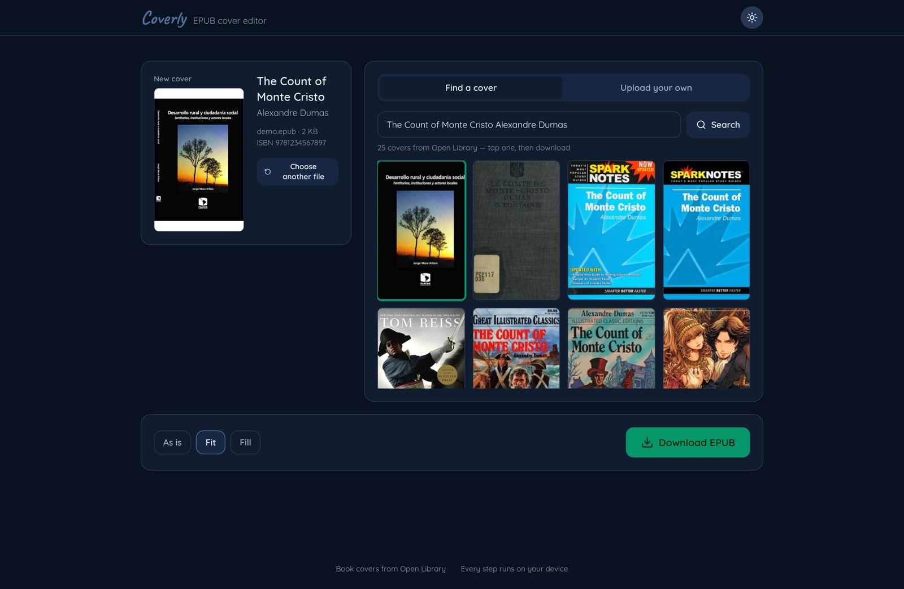

<p align="center">
  
</p>

<h1 align="center">Coverly</h1>

<p align="center">
  Add or replace the cover of an EPUB, from your browser.<br/>
  Made for books that arrive without artwork.
</p>

<p align="center">
  
  
  
  
  
  
  
</p>

---

Coverly is a single-page PWA for one job: a book file lands on your disk
without a cover, and you want it to have one. Pick art from
[Open Library](https://openlibrary.org) using the book's own title, author,
and ISBN, or upload any picture. The EPUB never leaves the device. The
browser parses the zip, swaps the cover, and hands the result back as a
download; there is no application server.

<p align="center">
  
</p>

## How it works

1. Drop an `.epub`. Title, author, and ISBN come from the file itself.
2. A cover grid loads from Open Library, searched with the book's own
   metadata. Search again with any words, or upload a jpeg, png, or webp.
3. Choose **As is**, **Fit** (pads to 1:1.6 book shape), or **Fill**
   (center-crops to book shape), then download. The output keeps every
   other file byte-identical; only the cover image and the OPF package
   file change. DRM-protected books are rejected with a clear message.

<table>
  <tr>
    <td align="center" width="33%">
      <br/>
      <sub>The whole app: one drop target</sub>
    </td>
    <td align="center" width="33%">
      <br/>
      <sub>Cover applied, fit or fill, then download</sub>
    </td>
    <td align="center" width="33%">
      <br/>
      <sub>Dark mode</sub>
    </td>
  </tr>
</table>

## Privacy model

- The EPUB is parsed in memory (JSZip + DOMParser) and rebuilt in memory.
  The download is a client-side blob. Nothing is uploaded, because there
  is nothing to upload to.
- The only network calls are Open Library search and its cover CDN, both
  `Access-Control-Allow-Origin: *` endpoints that need no key.
- A strict Content-Security-Policy allows scripts, fonts, and fetches from
  the app itself plus the Open Library and archive.org image hosts, and
  nothing else.
- Input gates before anything is parsed: `.epub` extension, zip magic
  bytes, a 400 MB size cap, and an early rejection of DRM-protected
  books. Uploaded covers must decode as jpeg, png, or webp.

## Run it

```bash
docker compose up -d --build
# open http://localhost:8420
```

The image is nginx serving static files: read-only rootfs, dropped
capabilities, 64 MB limit. Any static host works just as well, the `dist/`
output of `npm run build` is the whole application.

Dev mode:

```bash
npm install
npm run dev   # vite on :5173
```

One browser rule to know: service workers only run on `localhost` or over
HTTPS. Over plain `http://<lan-ip>` the app works fully (drop, swap,
download) but the browser will not offer "install as app" and offline mode
is off. For install on other devices, serve it behind any HTTPS endpoint.

## Tests

`npm test` builds sample EPUBs (coverless, EPUB2 cover, EPUB3 cover, DRM,
broken), swaps covers through the real engine, and checks:

- the repacked zip passes Python's `zipfile` with `mimetype` first, STORED
- old cover files and references are removed, new ones added for both
  EPUB2 (`<meta name="cover">`) and EPUB3 (`properties="cover-image"`)
- every unrelated zip member is byte-identical to the input

`npm run test:e2e` drives the built app in headless Chromium: load a
sample book, pick a real Open Library cover, download, verify the result
with the engine again. It fails on any console error, which catches CSP
violations and CORS misses too.

## Layout

```text
src/lib/epub.ts     parse / replace / repack (browser JSZip, DOMParser)
src/lib/covers.ts   Open Library search + cover URLs (no API key, CORS *)
src/lib/image.ts    canvas fit/fill pipeline, 1600px cap, no upscaling
src/components/     Dropzone, BookCard, CoverPanel, ActionCard, Toasts
test/               sample-EPUB generator + engine test suite
nginx.conf          cache policy for the PWA (SW never cached)
```

## Credits

- Cover art from [Open Library](https://openlibrary.org), an open,
  community book database run by the Internet Archive.
- Quicksand and Caveat are self-hosted through
  [Fontsource](https://fontsource.org), so the installed PWA needs no
  network at all.
- Built on React, JSZip, lucide icons, and Tailwind CSS.
